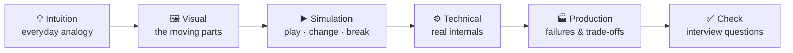
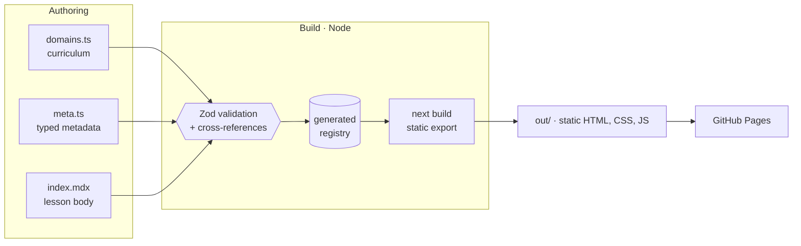

<div align="center">

<a href="https://aqkprogrammer.github.io/visual-engineering/">
  <picture>
    <source media="(prefers-color-scheme: dark)" srcset="docs/assets/hero-dark.svg">
    
  </picture>
</a>

# Visual Engineering

**Complex engineering concepts. Made visual. Made simple.**

Interactive, open-source lessons on system design, AI engineering, containers, cloud, networking and computer science —<br>
built to be watched, changed and broken, not just read.

<p>
  <a href="https://aqkprogrammer.github.io/visual-engineering/"><b>🌐 Open the live site</b></a>
  &nbsp;·&nbsp;
  <a href="https://aqkprogrammer.github.io/visual-engineering/system-design/load-balancing/">▶️ Start the first lesson</a>
  &nbsp;·&nbsp;
  <a href="#-curriculum">🧭 Curriculum</a>
  &nbsp;·&nbsp;
  <a href="#-roadmap">🗺️ Roadmap</a>
  &nbsp;·&nbsp;
  <a href="#-contributing">🤝 Contribute</a>
</p>

[](https://github.com/aqkprogrammer/visual-engineering/actions/workflows/ci.yml)
[](https://github.com/aqkprogrammer/visual-engineering/actions/workflows/deploy.yml)


[](LICENSE)

</div>

---

## ✨ Why this exists

Most explanations of how systems work are static — a diagram and a wall of text. But the interesting part of a system is what it **does**: what happens when traffic doubles, a server dies, or a cache goes cold. Visual Engineering shows that behaviour directly.

| | |
|---|---|
| 🎯 **One lesson, every level** | Beginners get an analogy and a picture; engineers get the internals; seniors get failure modes and trade-offs. |
| 🧪 **Honest simulations** | Deterministic *teaching models* that state their assumptions. Illustrative numbers are labelled — never passed off as benchmarks. |
| 📚 **Sourced, dated content** | Every lesson cites official docs and specs and shows when it was last reviewed. Analogies are marked as analogies. |
| ♿ **Accessible by default** | Keyboard-operable, screen-reader friendly, reduced-motion aware, never colour-only — checked by axe on every page type. |
| 🔓 **Free, private, open** | No account, no API key, no tracking. Fonts are self-hosted at build time. |

## 🎓 How every lesson teaches



## 🧭 Curriculum

<!-- curriculum:start -->
**1 live lesson** · 7 domains · 43 modules · 220 planned topics. Expand a domain to see what's inside.

<details open>
<summary><b>System Design</b> — How large systems stay fast, available and correct under real traffic. <sub>🟢 1 live · 48 planned</sub></summary>

| Module | Live lessons | Planned topics |
|---|---|---|
| **Foundations** | — | System design fundamentals · Functional and non-functional requirements · Scalability and performance · Availability, reliability, durability and consistency · Horizontal versus vertical scaling |
| **Traffic & Edge** | [How load balancing works](https://aqkprogrammer.github.io/visual-engineering/system-design/load-balancing/) | Reverse proxies · API gateways · CDN and edge computing · Rate limiting |
| **Data at Scale** | — | Caching, invalidation and eviction · Database indexing and query optimization · SQL versus NoSQL · Replication and partitioning · Sharding · Consistent hashing |
| **Consistency & Coordination** | — | CAP theorem · PACELC · Eventual consistency · Distributed transactions · Saga pattern · Idempotency · Distributed locking |
| **Messaging & Async** | — | Message queues and event streaming · Kafka fundamentals · RabbitMQ fundamentals · Synchronous versus asynchronous communication · Event-driven architecture · Backpressure |
| **Resilience** | — | Circuit breakers, retries, timeouts and bulkheads · High availability · Disaster recovery · Observability |
| **Real-time & APIs** | — | WebSockets, polling and Server-Sent Events · API versioning · Service discovery · Multi-tenancy |
| **Case Studies** | — | URL shortener · Chat and messaging application · Social media feed · Video streaming platform · E-commerce system · Ride-booking platform · Notification service · File storage service · Payment processing system · Real-time analytics platform · Search service · AI-powered application |

</details>
<details>
<summary><b>Software Architecture</b> — Structuring code and services so they stay changeable. <sub>⚪ in progress · 22 planned</sub></summary>

| Module | Live lessons | Planned topics |
|---|---|---|
| **Architectural Styles** | — | Layered architecture · Clean architecture · Hexagonal architecture (ports and adapters) · Modular monolith architecture · Monoliths versus microservices · Micro-frontends |
| **Domain Modeling** | — | Domain-driven design · Service boundaries · CQRS · Event sourcing |
| **Design Principles** | — | SOLID principles · DRY, KISS and YAGNI · Dependency injection · Repository and unit-of-work patterns · Design patterns · Code organization |
| **API Design** | — | API-first design · REST versus GraphQL versus gRPC · Backend-for-frontend |
| **Evolving Systems** | — | Refactoring and technical debt · Strangler migration pattern · Architecture decision records |

</details>
<details>
<summary><b>AI Engineering</b> — From tokens and embeddings to retrieval, agents and production LLM systems. <sub>⚪ in progress · 37 planned</sub></summary>

| Module | Live lessons | Planned topics |
|---|---|---|
| **Foundations** | — | AI, ML, deep learning and generative AI · Supervised, unsupervised and reinforcement learning · Neural networks · Training versus inference |
| **Language Models** | — | Tokens and tokenization · Embeddings · Vector similarity and cosine similarity · Attention mechanisms · Transformers · Large language models · Pretraining, fine-tuning and inference |
| **Building with LLMs** | — | Prompt engineering · Structured outputs · Function and tool calling |
| **Retrieval & RAG** | — | Retrieval-augmented generation (RAG) · Document ingestion and chunking · Embedding pipelines · Vector databases · Hybrid retrieval and reranking · RAG evaluation |
| **Agents** | — | AI agents and agentic workflows · Planning, memory, tools and execution · Model Context Protocol (MCP) · Multi-agent systems |
| **Production AI** | — | AI gateways and model routing · Semantic caching · Model latency, throughput and cost · GPU inference fundamentals · Quantization · AI observability and tracing |
| **Safety & Quality** | — | Hallucinations and grounding · Guardrails and prompt injection · LLM evaluation · AI security and privacy |
| **Multimodal AI** | — | Multimodal AI · Computer vision · Speech recognition and text-to-speech |

</details>
<details>
<summary><b>Containers & Kubernetes</b> — Packaging software and keeping it running across a fleet of machines. <sub>⚪ in progress · 36 planned</sub></summary>

| Module | Live lessons | Planned topics |
|---|---|---|
| **Containers & Docker** | — | Virtual machines versus containers · Container isolation · Docker architecture · Images and layers · Dockerfiles, build contexts and build cache · Multi-stage builds · Container registries · Volumes and persistent storage · Container networking · Compose · Environment variables and secrets · Image optimization · Container security |
| **Kubernetes Core** | — | Kubernetes architecture · Control plane and worker nodes · Pods · Deployments and ReplicaSets · Services · Ingress and Gateway API concepts · ConfigMaps and Secrets · Namespaces · Labels and selectors |
| **Workloads & Storage** | — | StatefulSets · DaemonSets · Jobs and CronJobs · Persistent volumes and claims |
| **Kubernetes Operations** | — | Resource requests and limits · Health checks and probes · Horizontal Pod Autoscaler · Scheduling · Rolling deployments and rollbacks · Self-healing · Service discovery · Network policies · Helm · Troubleshooting common Kubernetes failures |

</details>
<details>
<summary><b>Cloud & Infrastructure</b> — Networks, compute, storage and delivery pipelines in the cloud. <sub>⚪ in progress · 32 planned</sub></summary>

| Module | Live lessons | Planned topics |
|---|---|---|
| **Cloud Foundations** | — | Cloud computing fundamentals · AWS global infrastructure · Regions and Availability Zones |
| **Cloud Networking** | — | VPCs, subnets, routing and NAT · Security groups and network ACLs · DNS and Route 53 · Load balancers · CloudFront |
| **Compute & Data Services** | — | EC2 · Lambda · ECS versus EKS versus Lambda · S3 · RDS · DynamoDB · SQS and SNS · API Gateway |
| **Identity & Security** | — | IAM users, roles and policies · IAM least privilege · Secrets management |
| **Infrastructure as Code** | — | Infrastructure as Code · Terraform · State files and modules |
| **Delivery** | — | CI/CD · GitHub Actions · Blue-green and canary deployments |
| **Operations & Cost** | — | Autoscaling · Backups and disaster recovery · CloudWatch · Metrics, logs, traces and alerting · SLI, SLO and SLA · Cost optimization · FinOps fundamentals |

</details>
<details>
<summary><b>Networking & Web</b> — What actually happens between typing a URL and seeing a page. <sub>⚪ in progress · 20 planned</sub></summary>

| Module | Live lessons | Planned topics |
|---|---|---|
| **Internet Basics** | — | How the internet works · IP addressing and ports · Packet routing · TCP versus UDP · Network latency |
| **Naming** | — | DNS resolution |
| **Web Protocols** | — | HTTP and HTTPS · TLS handshake · HTTP/1.1, HTTP/2 and HTTP/3 · Browser request lifecycle · WebSockets · Connection pooling |
| **Web Identity** | — | Cookies and sessions · JWT · OAuth 2.0 and OpenID Connect · CORS |
| **Edge & Network Security** | — | Reverse proxy versus forward proxy · CDN · Firewalls · Zero-trust networking |

</details>
<details>
<summary><b>Computer Science</b> — The data structures, algorithms and systems concepts everything else is built on. <sub>⚪ in progress · 25 planned</sub></summary>

| Module | Live lessons | Planned topics |
|---|---|---|
| **Data Structures** | — | Arrays, linked lists, stacks and queues · Hash tables · Trees and graphs · Heaps and tries |
| **Algorithms** | — | Big O notation · Sorting and searching · Recursion · Dynamic programming · Greedy algorithms |
| **Concurrency** | — | Concurrency and parallelism · Threads and processes · Async programming · Race conditions and deadlocks |
| **Operating Systems** | — | Operating system fundamentals · Memory management · Garbage collection |
| **Database Internals** | — | Database transactions · ACID properties · Indexes · Database isolation levels |
| **Engineering Practice** | — | Testing strategies · Unit, integration, contract and end-to-end testing · Security fundamentals · OWASP concepts · Performance profiling |

</details>
<!-- curriculum:end -->

## 🗺️ Roadmap

- [x] **Phase 0 — Plan.** Requirements, taxonomy, architecture, design direction → [`docs/PLAN.md`](docs/PLAN.md)
- [x] **Phase 1 — Foundation.** Static site, design system, content pipeline, first lesson, tests, CI, GitHub Pages
- [ ] **Phase 2 — Simulation engine.** Play / pause / step / speed controls, failure injection, reduced-motion step mode; demos for load balancing, the TLS handshake and Kubernetes self-healing
- [ ] **Phase 3 — First 12 lessons** across system design, AI, containers, networking and CS
- [ ] **Phase 4 — Platform.** Search, learning paths, glossary, quizzes, interview hub, local progress
- [ ] **Phase 5 — Quality.** Accessibility audit, performance budgets, contributor guide
- [ ] **Later.** System design simulator, incident lab, interview arena, AI engineering playground

## 🏗️ How it's built



**Next.js 16** (App Router, fully static) · **React 19** · **TypeScript 6** (strict) · **Tailwind CSS 4** with OKLCH design tokens · **MDX** + **Zod** · **Shiki** (build-time highlighting) · **Vitest** · **Playwright** + **axe-core** · **GitHub Actions**

Every route is prerendered — there is no server. Read the [architecture overview](docs/ARCHITECTURE.md) and the [decision records](docs/adr/) for the why behind each choice.

<details>
<summary><b>📁 Project structure</b></summary>

```
app/                     routes and layouts (all statically generated)
components/
  layout/                header, footer, breadcrumbs, theme toggle
  lessons/               lesson building blocks used from MDX
  visualizations/        diagrams (simulation engine arrives in Phase 2)
content/
  domains.ts             curriculum: domains → modules → planned topics
  lessons/<domain>/<slug>/
    meta.ts              typed metadata (validated)
    index.mdx            lesson body
lib/
  content/               schemas, validation, MDX analysis, catalog queries
  design/                design tokens and colour-contrast maths
scripts/
  content.ts             validates content, generates the registry
  readme.ts              generates this README's banner and curriculum
tests/                   unit, component and end-to-end suites
docs/                    plan, architecture, ADRs, assets
```

</details>

## 🚀 Quick start

Requires **Node.js 24+** and **pnpm 11** (`corepack enable` installs the pinned version).

```bash
pnpm install
pnpm dev
```

Then open http://localhost:3000.

<details>
<summary><b>⌨️ All commands</b></summary>

| Command | What it does |
|---|---|
| `pnpm dev` | Validate content, then start the dev server |
| `pnpm build` | Validate content and build the static site into `out/` |
| `pnpm preview` | Serve `out/` locally on port 3000 |
| `pnpm content` | Validate all content and regenerate the registry |
| `pnpm readme` | Regenerate the README banner and curriculum section |
| `pnpm lint` · `pnpm format` | ESLint (zero warnings allowed) · Prettier |
| `pnpm typecheck` | Strict TypeScript check |
| `pnpm test` | Unit and component tests |
| `pnpm test:e2e` | End-to-end and accessibility tests against `out/` (run `pnpm build` and `pnpm exec playwright install chromium` first) |
| `pnpm check` | Everything CI runs except E2E |

</details>

## ✍️ Writing a lesson

<details>
<summary><b>Add a lesson in four steps</b></summary>

1. Create `content/lessons/<domain>/<slug>/` — the domain must exist in `content/domains.ts`.
2. Add `meta.ts`:

   ```ts
   import { defineLesson } from "@/lib/content/schema";

   export default defineLesson({
     slug: "consistent-hashing",
     domain: "system-design",
     module: "data",
     title: "How consistent hashing works",
     description: "Why adding a server to a hash ring moves only a fraction of keys, and how virtual nodes keep load even.",
     difficulty: "intermediate",
     prerequisites: ["system-design/load-balancing"],
     tags: ["hashing", "partitioning"],
     references: [/* at least two https sources, official docs first */],
     lastReviewed: "2026-10-12",
     status: "draft",
   });
   ```

3. Write `index.mdx`. `<Definition>`, `<Analogy>`, `<Callout kind="note|warning|illustrative">`, `<Steps>`, `<TradeOffs>` and `<InterviewQuestion>` are available without imports. Leave a blank line inside block tags so their content is parsed as Markdown.
4. Run `pnpm content` — it reports every problem at once: unknown modules, broken prerequisite links, cycles, links to drafts.

Drafts are visible in `pnpm dev` only. Reading time and the table of contents are generated for you.

</details>

## ✅ Quality gates

| Check | Tooling | Runs |
|---|---|---|
| Lint (React, hooks, Next.js, jsx-a11y) with zero warnings | ESLint 10 | CI |
| Formatting | Prettier | CI |
| Strict types | TypeScript 6 | CI |
| Content schema, cross-references, prerequisite cycles | Zod + custom validation | every build |
| Unit and component tests, WCAG contrast of every design token | Vitest + Testing Library | CI |
| Journeys, 404s, keyboard, theme, no horizontal scroll — desktop and mobile | Playwright | CI |
| WCAG 2.2 A/AA scan of every page type in both themes | axe-core | CI |
| Production dependency audit | pnpm audit | CI |
| README banner and curriculum match the real content | `scripts/readme.ts --check` | CI |
| Only green commits deploy | GitHub Actions → Pages | on `main` |

## 🤝 Contributing

Corrections, new lessons and simulation ideas are welcome — open an issue or a pull request. A full contribution guide arrives in Phase 5. Please report security problems privately as described in [SECURITY.md](SECURITY.md).

## 📄 License

[MIT](LICENSE) © 2026 Abdul Qadir Khan — covering the code, lessons and diagrams alike.
